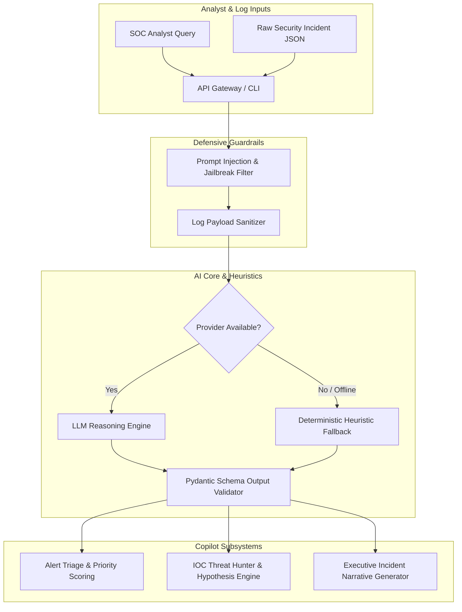

# AI Security Operations Assistant (SecOps Copilot)

Autonomous AI Security Operations Assistant (SecOps Copilot) designed to amplify Security Operations Center (SOC) Tier 1–3 analysts with guardrailed alert triage, threat hunting, and incident narrative generation.

[](https://github.com/Krish9800/ai-security-operations-assistant/actions)
[](https://www.python.org/)
[](https://mypy.readthedocs.io/)
[](https://docs.astral.sh/ruff/)
[](https://github.com/PyCQA/bandit)

---

## Overview & Problem Statement

Modern SOC teams face severe alert fatigue: thousands of daily alerts inundate analysts, resulting in delayed Mean Time to Respond (MTTR) and missed high-severity intrusions. While generative AI models can assist with triage, naive LLM integrations introduce significant security risks: prompt injection attacks from untrusted log payloads, hallucinations, and unauthorized command execution.

**AI Security Operations Assistant** provides a production-grade, security-hardened copilot. It integrates deterministic input validation, prompt-injection defense guardrails, schema-enforced Pydantic responses, and an offline local heuristic fallback to ensure safe, auditable SOC assistance.

---

## Architecture & Data Flow



---

## Verified Features

- **Automated Alert Triage:** Ingests raw alerts, calculates contextual severity scores, and tags relevant MITRE ATT&CK tactics.
- **Deterministic Security Guardrails:**
  - Regex and heuristic prompt-injection filters intercept adversarial jailbreak attempts embedded in log fields.
  - Strict Pydantic output validation prevents malformed responses.
  - Absolute zero-execution boundary: never evaluates untrusted shell commands or scripts.
- **Automated Threat Hunting:** Analyzes suspicious IOCs (hashes, domains, IPs) and generates structured threat-hunting hypotheses.
- **Executive Incident Narratives:** Translates technical forensic logs into structured executive summaries and containment steps.
- **Dual Execution Modes:** Seamlessly toggles between LLM providers (OpenAI, Anthropic, Ollama) and an offline deterministic heuristic engine requiring zero external API keys.

---

## Technology Stack

- **Runtime:** Python 3.12+
- **Data Validation & Schemas:** Pydantic v2 & Pydantic-Settings
- **REST Service:** FastAPI & Uvicorn
- **CLI:** Typer & Rich
- **Quality Gates:** Pytest, Ruff, Mypy Strict, Bandit SAST

---

## Requirements & Installation

### Requirements
- Linux / macOS / WSL2 on Windows
- Python 3.12+

### Installation

```bash
# Clone the repository
git clone https://github.com/Krish9800/ai-security-operations-assistant.git
cd ai-security-operations-assistant

# Create and activate virtual environment
python3 -m venv .venv
source .venv/bin/activate

# Install dependencies
pip install -e .
```

---

## Configuration

Settings are configured via environment variables or a `.env` file:

| Variable | Type | Default | Description |
|----------|------|---------|-------------|
| `AI_SECOPS_ENV` | string | `development` | Operating environment (`development`, `production`) |
| `AI_SECOPS_PROVIDER` | string | `heuristic` | AI Provider (`heuristic`, `openai`, `anthropic`, `ollama`) |
| `AI_SECOPS_API_KEY` | string | `""` | API key for cloud provider (optional for heuristic mode) |
| `AI_SECOPS_MODEL` | string | `default` | Model identifier |
| `AI_SECOPS_GUARDRAILS_ENABLED` | boolean | `true` | Enforce strict prompt-injection defense |

---

## Verified Usage Examples

### 1. Command-Line Interface (CLI)

```bash
# Ask a general security operational question
ai-secops query "How do I investigate a suspected Pass-the-Hash attack on Windows Server?"

# Triage a security incident payload
ai-secops triage sample_data/incident_alert.json

# Generate an executive incident narrative
ai-secops narrative sample_data/incident_alert.json

# Conduct an automated threat hunting hypothesis check on IOCs
ai-secops hunt sample_data/ioc_list.json

# Start an interactive terminal analyst copilot session
ai-secops chat
```

### 2. REST API Service

```bash
# Start the copilot API daemon
ai-secops serve --host 127.0.0.1 --port 8000
```

Key Endpoints (`http://127.0.0.1:8000/docs`):
- `GET /health` — Health check and active AI provider status
- `POST /api/v1/copilot/chat` — Guardrailed conversational analyst interface
- `POST /api/v1/copilot/triage` — Structured incident triage and scoring
- `POST /api/v1/copilot/hunt` — Automated threat hunting hypothesis generator
- `POST /api/v1/copilot/narrative` — Forensic report and narrative synthesis

---

## Testing & Quality Gates

```bash
# Run complete test suite with coverage
pytest --cov=ai_secops --cov-report=term-missing

# Run prompt-injection and guardrail security tests
pytest tests/security/test_adversarial.py

# Strict type checking and code quality
ruff check .
mypy src/ai_secops
bandit -r src/ai_secops
```

---

## Security Model & Threat Boundaries

- **Prompt Injection Defense:** External log payloads are treated as untrusted data and sanitized prior to context ingestion. Instruction markers in logs are neutralized.
- **Air-Gapped Privacy:** In `heuristic` mode, zero data leaves the local machine. Sensitive logs are never transmitted to external APIs without explicit configuration.
- **Zero-Execution Guarantee:** The assistant provides recommendations, code snippets, and queries; it does not possess autonomous execution privileges to alter firewalls or execute scripts.

---

## Limitations & Known Issues

- **Heuristic Mode Depth:** When operating without external LLM API keys, the local heuristic engine relies on deterministic pattern matching which covers standard attacks but lacks contextual creative reasoning.
- **Multi-Tenant Sessions:** Sessions are stored locally in-memory; enterprise deployments require persistent Redis session stores.

---

## Roadmap

- [ ] Redis-backed persistent conversation state.
- [ ] Native Ollama local LLM integration helper.
- [ ] Splunk / ELK direct query generator plugin.

---

## License & Attribution

This project is licensed under the **MIT License**.

> [!NOTE]
> Designed for SOC analysts, incident response teams, and AI red team researchers.
