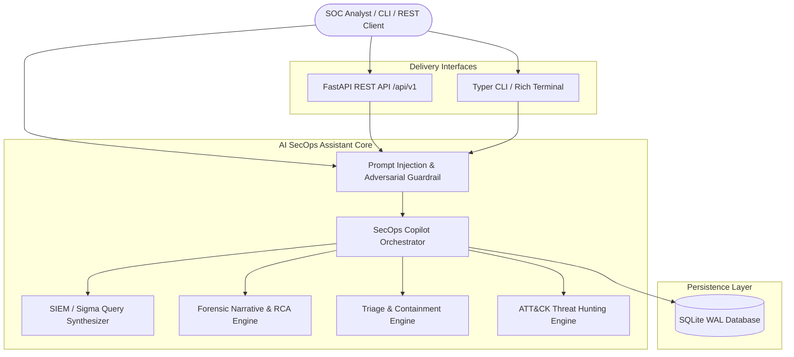

# AI Security Operations Assistant (SecOps Copilot)

[](https://github.com/portfolio/ai-security-operations-assistant/actions)
[](https://www.python.org/downloads/release/python-3120/)
[](https://mypy.readthedocs.io/)
[](https://docs.astral.sh/ruff/)
[](https://github.com/PyCQA/bandit)
[](https://pytest.org/)

An autonomous, enterprise-grade **AI Security Operations Assistant** (SecOps Copilot) designed to amplify Security Operations Center (SOC) Tier 1–3 analysts and incident response teams.

---

## Key Capabilities

1. **Natural Language to SIEM / Sigma Synthesizer**:
   - Translates analyst questions into syntactically validated queries for Splunk (SPL), Elasticsearch (KQL/DSL), and Sigma rule YAML.
   - Built-in syntax & safety validation (prevents dangerous commands like `| delete` and flags unbounded wildcard scans).

2. **Forensic Incident Narrative & Technical RCA Generator**:
   - Correlates multi-source telemetry (EDR, Firewall, Identity Provider, WAF, CloudTrail, DNS, Honeypot).
   - Generates executive summaries, chronological forensic timelines, and root cause analyses with MITRE ATT&CK mapping.

3. **Confidence-Calibrated Triage & Containment Engine**:
   - Calibrated recommendation actions: Host Isolation (`ISOLATE_HOST`), Session Revocation (`REVOKE_SESSION`), Perimeter IP Blocking (`BLOCK_IP`), Credential Rotation (`ROTATE_CREDENTIALS`), and File Quarantine (`QUARANTINE_FILE`).
   - Dynamic blast radius calculation enforcing mandatory human sign-off on critical assets (e.g. Domain Controllers, core databases).
   - Explicit rollback procedures for all proposed containment steps.

4. **Threat Hunting Hypothesis Generator**:
   - Proactive threat hunting playbooks mapped to the MITRE ATT&CK Enterprise Matrix (T1059.001 PowerShell, T1003.001 LSASS dumping, T1078 Valid Accounts, T1021.002 SMB Admin Shares, T1055 Process Injection).
   - Generates ready-to-execute SIEM queries, analyst inspection checklists, and false positive guidance.

5. **Prompt-Injection & Adversarial Defense Guardrail**:
   - Intercepts direct and indirect prompt injection attempts, persona hijacking (DAN), and system prompt leaks.
   - Automated secret and PII redaction (`[REDACTED_API_KEY]`, `[REDACTED_BEARER_TOKEN]`, `[REDACTED_PASSWORD]`).
   - Shell metacharacter and path traversal validation on tool parameters.

6. **SQLite WAL Persistence & Control Plane**:
   - SQLite Write-Ahead Logging (`PRAGMA journal_mode = WAL;`) for concurrent read/write and audit logging.
   - FastAPI REST API control plane with OpenAPI 3.1 documentation.
   - Typer CLI with rich terminal formatting and interactive conversational mode.

---

## System Architecture



---

## Installation & Setup

### Prerequisites
- Python 3.12+
- Virtualenv or Docker

### Local Installation
```bash
# Clone and enter directory
git clone https://github.com/portfolio/ai-security-operations-assistant.git
cd ai-security-operations-assistant

# Create virtual environment
python3 -m venv .venv
source .venv/bin/activate

# Install dependencies in editable mode
pip install -e ".[dev]"
```

---

## CLI Usage Guide

The `ai-secops` CLI provides instant SecOps operations from your terminal:

```bash
# 1. Synthesize SIEM queries from natural language
ai-secops query "Find brute force failed login attempts from external IPs" --target spl
ai-secops query "Detect powershell encoded commands and download cradles" --target sigma
ai-secops query "Alert on shadow copy deletion with vssadmin" --target elasticsearch

# 2. Ingest alerts and run automated triage
ai-secops triage samples/alerts.json

# 3. Generate forensic narrative and Root Cause Analysis
ai-secops narrative samples/alerts.json

# 4. Generate threat hunting hypothesis or full playbook
ai-secops hunt T1059.001
ai-secops hunt credential-access --playbook

# 5. Interactive Copilot terminal chat session
ai-secops chat

# 6. Launch the FastAPI server
ai-secops serve --host 127.0.0.1 --port 8000
```

---

## REST API Reference

The FastAPI service exposes comprehensive REST endpoints documented at `http://127.0.0.1:8000/docs`:

| Method | Endpoint | Description |
| :--- | :--- | :--- |
| `GET` | `/health` | Health check probe |
| `POST` | `/api/v1/copilot/chat` | Chat with SecOps Copilot (enforces guardrail & query extraction) |
| `POST` | `/api/v1/synthesizer/generate` | Synthesize natural language into SPL, Elastic, or Sigma |
| `POST` | `/api/v1/narrative/generate` | Generate forensic narrative and technical RCA from alerts |
| `POST` | `/api/v1/recommender/triage` | Evaluate triage and confidence-calibrated containment actions |
| `PATCH`| `/api/v1/recommendations/{id}/status` | Update containment action status (`approved`, `executed`) |
| `POST` | `/api/v1/hunter/hypothesize` | Generate ATT&CK threat hunting hypothesis |
| `POST` | `/api/v1/hunter/playbook` | Generate structured hunting playbook |
| `GET` | `/api/v1/sessions` | List active chat sessions |
| `GET` | `/api/v1/sessions/{id}` | Retrieve session message history |
| `DELETE`| `/api/v1/sessions/{id}` | Delete session and cascade message audit records |

---

## Container Deployment (Rootless Docker)

```bash
# Build the rootless Docker container image
docker build -t ai-secops-assistant:latest .

# Run the container (non-root UID 10001)
docker run -d \
  -p 8000:8000 \
  -v $(pwd)/data:/app/data \
  --name ai-secops \
  ai-secops-assistant:latest
```

---

## Quality Gate Verification

All quality gates are enforced with strict standards:

```bash
# Code formatting check
ruff format --check

# Strict linting
ruff check

# 100% strict type hints
mypy --strict src tests

# Security vulnerability audit (Bandit AST scan)
bandit -r src/

# Run complete test suite with 90%+ coverage gate
pytest --cov --cov-fail-under=90
```

---

## Security & STRIDE Threat Model

Refer to [`docs/threat_model.md`](docs/threat_model.md) for the complete STRIDE threat analysis, blast radius policies, and adversarial defense architecture.
